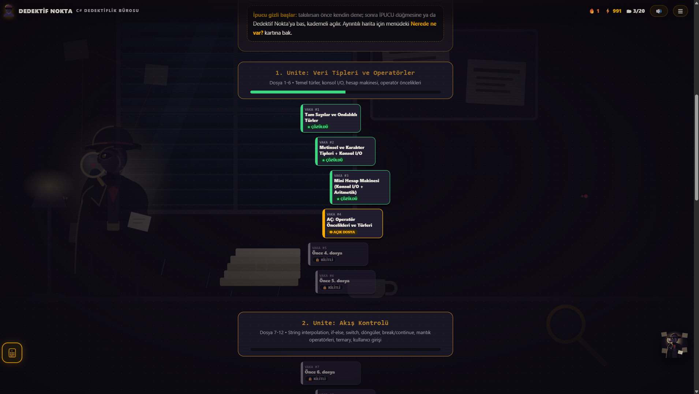
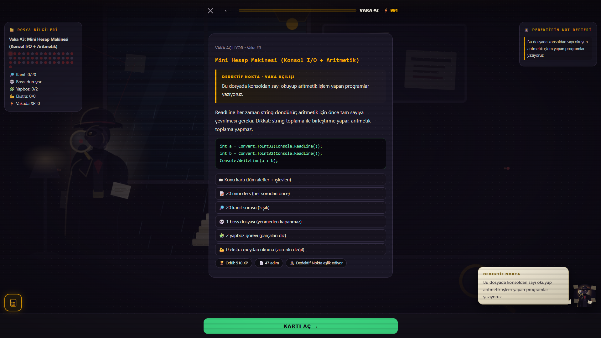
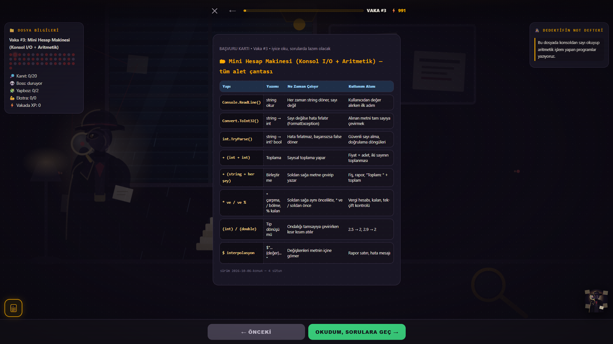
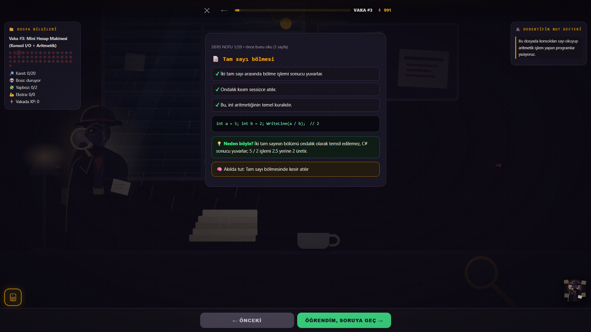
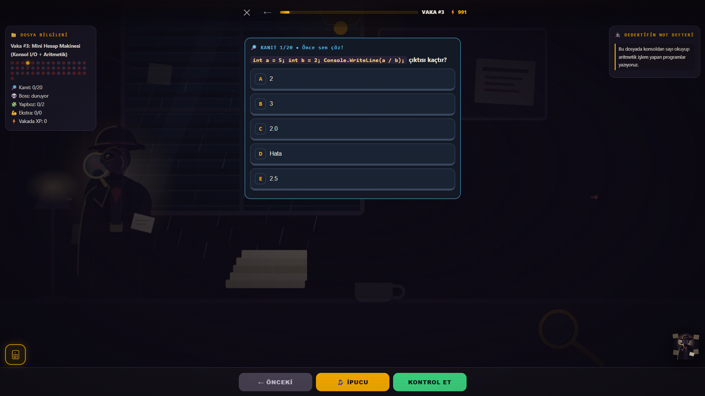

# C# Dedektiflik Bürosu — Dedektif Nokta

C# programlama öğrenmek için tarayıcı tabanlı, senaryo odaklı bir HTML/JS oyunu. Dedektif Nokta'nın masasında C#'ın temellerini 23 vakada çözersin: konsol, döngüler, metotlar, koleksiyonlar, stringler, OOP ve daha fazlası.

## Özellikler

- 🎮 Senaryo tabanlı ilerlemeli 23 dosya (vaka), 4 ünite
- ✅ 500 soru: çoktan seçmeli, KOD TAMAMLA, yapboz, boss soruları
- 🔥 Günlük seri ve XP sistemi (`localStorage` + Firestore)
- 👤 Google hesabıyla giriş; ilerleme cihazlar arası senkronlanır
- 🕵️‍♂️ Noir teması, yağmur/pencere/ofis arkaplan, maskot ipuçları
- 📱 Mobil ve masaüstü uyumlu
- 📦 PWA: `sw.js` ile çevrimdışı önbellek
- ✔️ Test verisindeki KOD TAMAMLA sorularının doğru cevapları CI'da .NET ile derlenip doğrulanır

## Ekran Görüntüleri

| Dosya Arşivi / Rehber                                  | Vaka Açılışı                                          |
| ------------------------------------------------------ | ----------------------------------------------------- |
|  |  |

| Başvuru Kartı                                           | Ders Notu                                       |
| ------------------------------------------------------- | ----------------------------------------------- |
|  |  |

| Kanıt Sorusu                                          |
| ----------------------------------------------------- |
|  |

## Kurulum

```bash
npm install
npm start        # http://localhost:8000
```

> Port 8000 şart: Firebase API key referrer kısıtlaması `localhost:8000`'e izin veriyor.

### Firebase yapılandırması

Gerçek Firebase yapılandırması Git deposunda tutulmaz. Google girişi olmadan da ilerleme cihazda kaydedilir.

Netlify'da **Site configuration → Environment variables** bölümüne `NOIR_FIREBASE_CONFIG` ekle. Değer, `firebase-config.example.js` içindeki nesnenin kendi Firebase projenin değerleriyle doldurulmuş geçerli JSON karşılığı olmalıdır. `window.NOIR_FIREBASE_CONFIG =` kısmını ve sondaki noktalı virgülü ekleme. Değişkenin build sırasında erişilebilir olduğundan emin ol.

`npm run build`, bu değerden Git tarafından izlenmeyen `assets/firebase-config.js` dosyasını üretir. Değişken yoksa anahtarsız bir dosya üretir ve Google girişi kapalı kalır. Oluşturulan dosyanın içeriği günlük çıktısına yazdırılmaz.

Yerel sunucuda Google girişi için aynı ortam değişkenini tanımlayıp `npm start` çalıştır. Alternatif olarak `firebase-config.example.js` dosyasını `assets/firebase-config.js` konumuna kopyalayıp kendi değerlerini doldur ve doğrudan statik sunucu başlat. `npm start`, build adımını çalıştırıp bu dosyayı ortam değişkeninden yeniden üretir.

Firebase web yapılandırması uygulama çalışırken tarayıcıya gönderilir; ortam değişkeni kullanmak onu tarayıcıdan gizlemez. Güvenlik için Firebase API kısıtlamaları, yetkili alan adları ve uygun Firestore kuralları gerekir.

### Yayınlama

Netlify, `netlify.toml` içindeki `npm run build` komutunu çalıştırır ve kök klasörü yayınlar. Ortam değişkenini değiştirdikten sonra yeniden deploy et.

Manuel dağıtımda önce `npm run build` çalıştır ve üretilen `assets/firebase-config.js` dahil klasörü yükle. Yalnızca ZIP sürükleyip bırakmak build komutunu çalıştırmaz.

## Dosyalar

| Dosya veya klasör                                    | Ne işe yarar                                                                             |
| ---------------------------------------------------- | ---------------------------------------------------------------------------------------- |
| `index.html`                                         | C# ve C bölümlerine açılan ana sayfa                                                     |
| `CSharp Dedektiflik bürosu.html`                     | C# dersleri ve oyun motoru                                                               |
| `c-kod-atolyesi.html`                                | C bağlı liste vakaları ve alıştırmaları                                                  |
| `assets/`                                            | Aktif sayfaların stilleri, betikleri, haritaları ve animasyonları                        |
| `assets/progress-store.js`                           | Cihazdaki ilerleme kaydı                                                                 |
| `assets/firebase-account.js`                         | Google girişi ve ilerleme eşitleme                                                       |
| `assets/firebase-config.js`                          | Build sırasında üretilen, Git tarafından izlenmeyen yapılandırma                         |
| `firebase-config.example.js`                         | Gerçek anahtar içermeyen yapılandırma örneği                                             |
| `scripts/write-firebase-config.mjs`                  | Yayın ortamından Firebase yapılandırması üretir                                          |
| `sw.js`, `manifest.webmanifest`                      | PWA ve çevrimdışı önbellek                                                               |
| `data.js`                                            | Mevcut soru testleri ve .NET doğrulaması için korunan veri; sayfalar bu dosyayı yüklemez |
| `tests/data.test.mjs`                                | Test verisinin tutarlılığını denetler                                                    |
| `scripts/validate-questions.mjs`, `tools/validator/` | Test verisindeki C# kod cevaplarını .NET ile doğrular                                    |
| `firestore.rules`                                    | Firebase için depo içindeki kural dosyası                                                |
| `netlify.toml`                                       | Build, yayın başlıkları ve eski sayfa adresleri için yönlendirmeler                      |

Yüklenmeyen eski sinema, film, macera, soruşturma ve bağımsız laboratuvar modülleri kaldırıldı.
Eski HTML adresleri Netlify üzerinden güncel bölümlere yönlendirilir.
Derslerde kullanılan `assets/case-loops/` animasyonları, posterleri ve `assets/c-question-video.js` korunur.

## Tasarım notları

**Vaka 20** ("Beceri Temelli Soru 2") yalnızca KOD TAMAMLA sorularından oluşur; çoktan seçmeli
ve boss sorusu bilinçli olarak yoktur. `tests/data.test.mjs` bu vakayı istisna olarak işaretler.

**Firebase API key'i** tarayıcıya inmesi gereken bir değerdir, gizlenemez. Repoda tutulmaz;
güvenlik Google Cloud'daki API/referrer kısıtlamaları ve `firestore.rules` ile sağlanır.

## Testler

```bash
npm test              # soru verisi bütünlüğü
npm run validate      # KOD TAMAMLA sorularını .NET ile derleyip karşılaştırır
npm run format:check  # biçim kontrolü
```

CI her push'ta bu üçünü koşar.

## Katkı

`CONTRIBUTING.md` dosyasına bak.

## Lisans

- Uygulama kodu: MIT (`LICENSE`)
- Soru verisi (`data.js`): tr.wikibooks _C#_ kaynaklarından esinli, CC BY-SA 4.0
