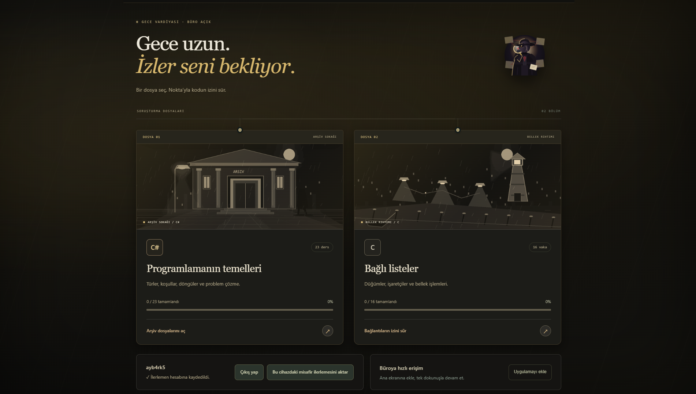
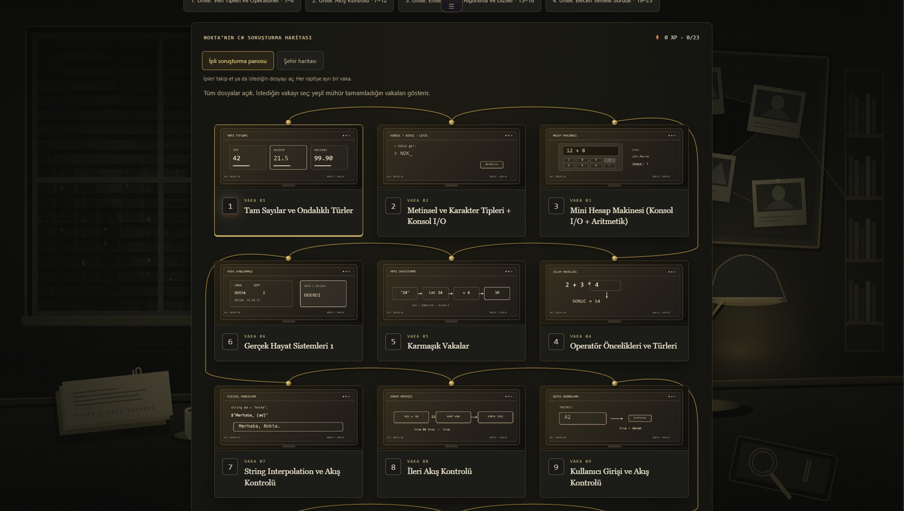
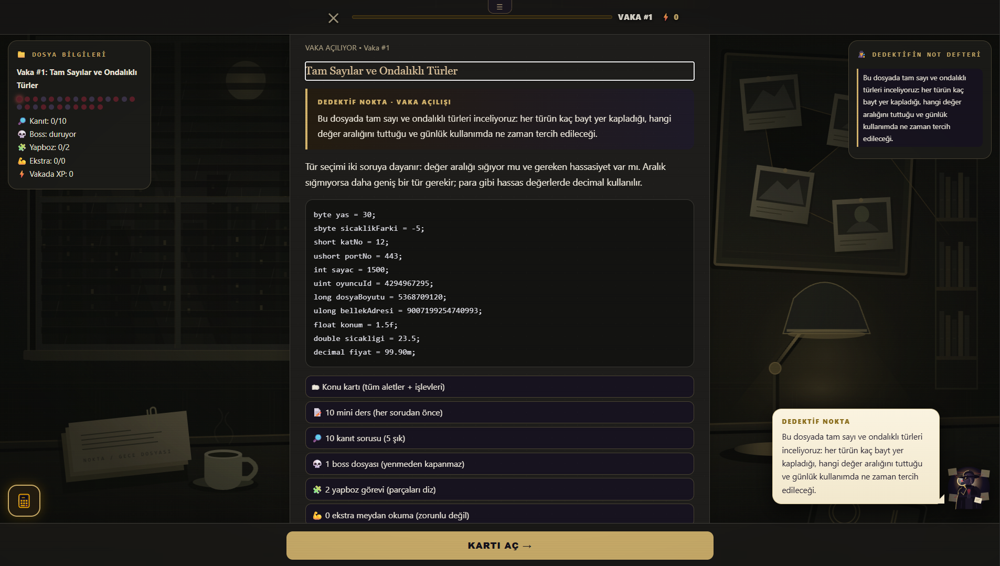
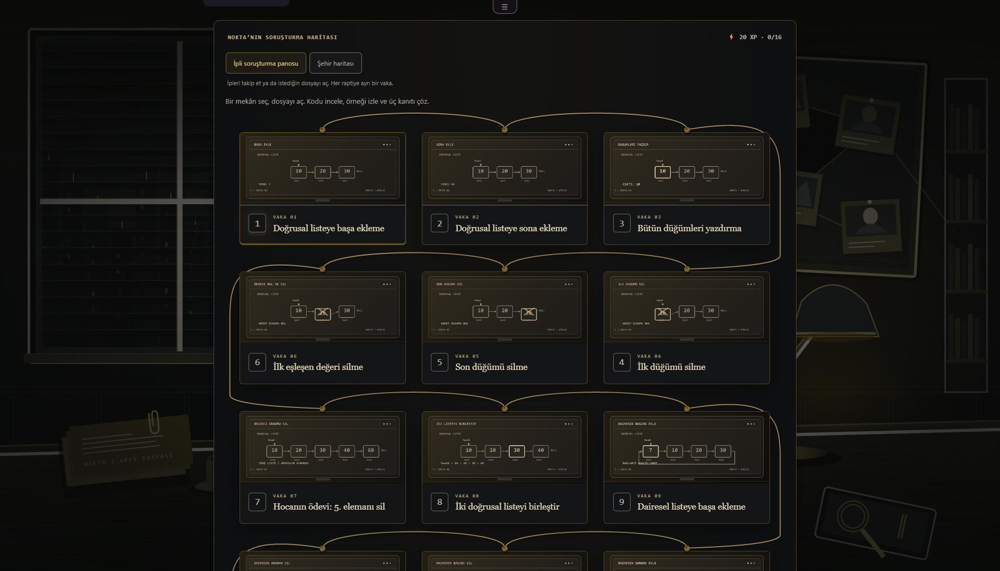
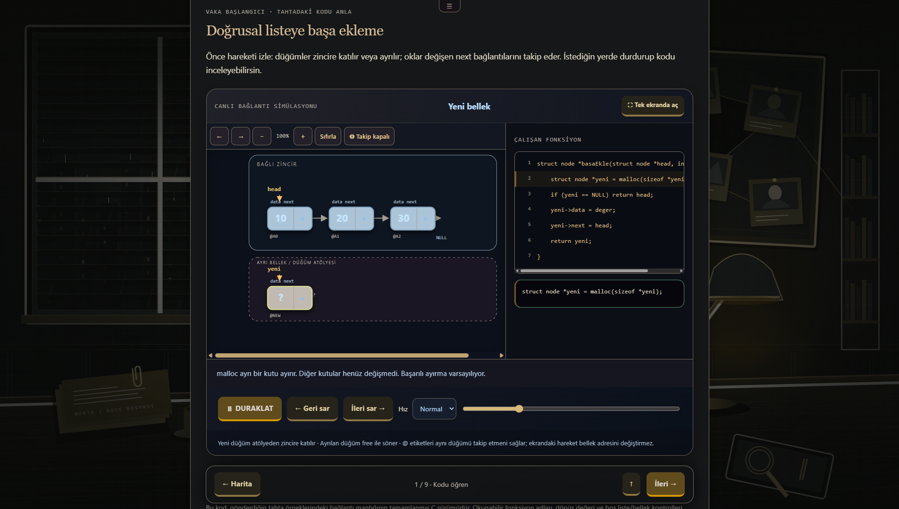

# Dedektif Nokta — C# ve C Programlama Bürosu

Dedektif Nokta, programlamayı vaka çözerek öğrenmeye yönelik, tarayıcıda çalışan bir eğitim uygulamasıdır. Ana sayfadaki iki dosya iki ayrı öğrenme bölümüne açılır: **C# programlamanın temelleri** ve **C dilinde bağlı listeler**.

Bir vaka seçer, konu açıklamasını okur, kodun nasıl çalıştığını inceler ve alıştırmaları çözersin. Noir temalı büro, soruşturma panosu, animasyonlar ve Dedektif Nokta bu akışa eşlik eder.

## İki bölüm, iki öğrenme yolu

| Bölüm                  | Kapsam                              | İçerik                                                                                               |
| ---------------------- | ----------------------------------- | ---------------------------------------------------------------------------------------------------- |
| **C# — Arşiv Sokağı**  | Programlamanın temelleri            | 33 vaka, 4 ünite; konu kartları, mini dersler, kanıt soruları, kod tamamlama, kod yazma ve yapbozlar |
| **C — Bellek Rıhtımı** | Doğrusal ve dairesel bağlı listeler | 16 vaka; satır açıklamaları, görsel bağlantı simülasyonları, çözümlü örnekler ve uygulama soruları   |

### C# — Programlamanın temelleri

C# bölümünde vaka haritasından bir ders seçilir. Vaka açılışında konu ve örnek kod tanıtılır; ardından konu kartları, mini dersler ve sorularla ilerlenir. Vakanın içeriğine göre kanıt soruları, boss sorusu, kod tamamlama, kod parçalarını sıralama ve ek alıştırmalar bulunur.

| Ünite                             | Vakalar | Konular                                                                                        |
| --------------------------------- | ------- | ---------------------------------------------------------------------------------------------- |
| Veri tipleri ve operatörler       | 1–6     | Tam ve ondalıklı sayılar, konsol giriş/çıkışı, hesaplamalar, tür dönüşümleri ve işlem önceliği |
| Akış kontrolü                     | 7–12    | String interpolation, koşullar, mantık operatörleri, switch, döngüler ve kullanıcı girişi      |
| Entegrasyon, algoritma ve diziler | 13–18   | Birden fazla konuyu birleştirme, algoritma kurma, diziler, metotlar ve özyineleme              |
| Beceri temelli sorular            | 19–23   | Gerçek hayat ve proje senaryolarıyla problem çözme                                             |

Vaka haritasında tamamlanan dosyalar işaretlenir; XP ve ilerleme bilgileri gösterilir.

### C# — Kod yazma vakaları

İlk 23 vakanın ardından **10 kod yazma vakası** gelir. Bu vakalarda cevabı seçmek veya kod parçalarını sıralamak yerine öğrenci kendi kodunu yazar.

Yazılan kod tarayıcıda çalıştırılmaz. Kod, `backend/` klasöründeki Roslyn tabanlı doğrulama sunucusuna gönderilir; sunucu kodu ayrıştırır ve kontrollü bir yorumlayıcıyla değerlendirir. Öğrenci kodu hiçbir zaman işletim sistemi süreci olarak başlatılmaz.

Sunucu yanıt verdiğinde oyun kod doğrulamasının bağlı olduğunu gösterir. Sunucuya ulaşılamazsa yalnızca kod yazma vakaları çalışmaz; dersler, sorular ve C bölümü etkilenmez.

### C — Bağlı listeler

C bölümü, **bağlı listeler ve işaretçiler** üzerine odaklanır. `struct node`, `data`, `next`, `head`, `NULL`, `malloc` ve `free` gibi kavramlar, düğümlerin ve bağlantıların değişimini gösteren örneklerle açıklanır.

16 vaka boyunca şu işlemler çalışılır:

- Doğrusal listenin başına ve sonuna düğüm ekleme.
- Düğümleri gezme ve yazdırma.
- İlk, son, belirli sıradaki veya ilk eşleşen düğümü silme.
- İki doğrusal listeyi birleştirme.
- Dairesel listeye ekleme ve dairesel listeden silme.
- Boş liste, tek düğüm, bulunamayan hedef ve tekrar eden değerler gibi özel durumlar.

Her vaka **dokuz adımlık** bir öğrenme akışı izler:

1. Fonksiyonun amacını, kodunu ve satırların görevini öğren.
2. Çözümlü örneğin animasyonunu izle.
3. Farklı bir girdide oluşacak sonucu bul.
4. Kod tamamlama için çözümlü örneği incele.
5. Üç eksik kod satırını tamamla.
6. Özel durum örneğini incele.
7. Özel durum sorusunu çöz.
8. Kod parçalarını doğru sıraya koy.
9. Vakayı tamamla ve sonraki dosyaya geç.

Görsel oynatıcıda düğümler, adresler ve bağlantılar kod satırlarıyla birlikte takip edilir. Oynat/duraklat, adım adım ilerleme, geri sarma ve hız ayarları bulunur. Vaka sonunda isteğe bağlı serbest kod alanı ve C dosyası indirme seçeneği vardır; indirilen kod yerel bir C ortamında çalıştırılabilir.

## İlerleme ve kullanım

- **Misafir kullanım:** XP, tamamlanan vakalar ve kod taslakları cihazın tarayıcısında saklanır. Tarayıcı verilerini temizlemek bu yerel kayıtları da kaldırır.
- **Google hesabı:** Firebase yapılandırıldığında giriş yapılabilir ve yönetilen ilerleme kayıtları hesapla eşitlenebilir. Misafir ilerlemesini hesaba aktarma seçeneği bulunur.
- **Mobil ve masaüstü:** Arayüz farklı ekran boyutlarına uyarlanır. Destekleyen tarayıcılarda ana ekrana uygulama olarak eklenebilir.
- **Çevrimdışı kullanım:** Service worker, daha önce açılan sayfa ve varlıkları önbellekten sunabilir. İlk ziyaret ve Google ile giriş/eşitleme internet bağlantısı gerektirir.

## Ekran Görüntüleri

### Ana sayfa



| C# vaka haritası                                                  | C# vaka açılışı                                                 |
| ----------------------------------------------------------------- | --------------------------------------------------------------- |
|  |  |

| C bağlı liste haritası                                                    | C bağlı liste simülasyonu                                                       |
| ------------------------------------------------------------------------- | ------------------------------------------------------------------------------- |
|  |  |

## Yerelde çalıştırma

Node.js ve npm kurulu bir bilgisayarda:

```bash
git clone https://github.com/Ayberkkisla/CSharp-Dedektiflik-Burosu.git
cd CSharp-Dedektiflik-Burosu
npm start
```

Tarayıcıda **http://localhost:8000** adresini aç.

`npm start`, önce Firebase yapılandırma dosyasını üretir, ardından statik sunucuyu başlatır. Firebase ortam değişkeni tanımlı değilse uygulama misafir modunda çalışır.

## Firebase ve Google girişi

Gerçek proje yapılandırması Git deposunda tutulmaz. `firebase-config.example.js`, doldurulacak alanları gösteren bir örnektir.

1. Kendi Firebase projende Google ile girişi ve Firestore'u yapılandır.
2. Kullanacağın yerel/yayın alan adlarını Firebase Authentication'ın yetkili alan adlarına ekle.
3. Yayın ortamında **`NOIR_FIREBASE_CONFIG`** adlı değişken oluştur.
4. Bu değişkene örnek dosyadaki nesnenin kendi proje değerlerinle doldurulmuş **geçerli JSON** karşılığını yaz. `window.NOIR_FIREBASE_CONFIG =` kısmını, yorumları ve sondaki noktalı virgülü ekleme.
5. Build çalıştır veya yeniden deploy et.

`npm run build`, ortam değişkeninden `assets/firebase-config.js` dosyasını oluşturur. Bu dosya Git tarafından izlenmez. Değişken yoksa anahtarsız yapılandırma üretilir ve Google girişi kapalı kalır; cihazdaki ilerleme kaydı çalışır.

Güncel hesap kodu kayıtları `dedektifUsers/{uid}/progress/{key}` yolunda tutar. Yayınladığın Firestore kuralları bu yapıyla uyumlu olmalıdır. **Depodaki `firestore.rules` eski `kayitlar/{uid}` yapısını içerir; güncel hesap eşitlemesi için uyarlanmadan kullanılmamalıdır.**

Firebase web yapılandırması çalışma sırasında tarayıcıya gönderilir. Ortam değişkeni, anahtarın Git deposuna yazılmasını önler; tarayıcıdan gizlenmesini sağlamaz. API kısıtlamaları, yetkili alan adları ve Firestore erişim kuralları ayrıca yapılandırılmalıdır.

## Netlify'da yayınlama

GitHub bağlantılı dağıtımda `netlify.toml` şu ayarları kullanır:

| Ayar          | Değer           |
| ------------- | --------------- |
| Build komutu  | `npm run build` |
| Yayın klasörü | `.`             |

Google girişi kullanılacaksa `NOIR_FIREBASE_CONFIG` değişkenini Netlify'ın ortam değişkenlerine ekle ve build sırasında erişilebilir olmasını sağla.

Manuel dağıtım için önce `npm run build` çalıştır; üretilen `assets/firebase-config.js` dahil klasörü yükle. Netlify'a yalnızca ZIP bırakmak build komutunu çalıştırmaz.

### Kod yazma vakaları için .NET sunucusu

Kod yazma vakaları, `backend/` klasöründeki .NET/Roslyn sunucusuna ihtiyaç duyar. Sunucu Render'da barındırılır; `render.yaml` Blueprint tanımı deponun kökündedir ve kurulum adımları `backend/DEPLOY-ADIMLARI.txt` dosyasındadır.

Oyun göreli `/api/check` ve `/api/health` adreslerini kullanır. `netlify.toml` içindeki `/api/*` yönlendirmesi bu istekleri Render adresine geçirir, böylece tarayıcıda CORS ayarı gerekmez. Sunucu adresi değişirse yalnızca bu satırdaki hedefi güncelle ve yeniden yayınla.

## Proje yapısı

| Dosya veya klasör                                              | Görevi                                                |
| -------------------------------------------------------------- | ----------------------------------------------------- |
| `index.html`                                                   | C# ve C bölüm seçimi                                  |
| `CSharp Dedektiflik bürosu.html`                               | C# ders içeriği ve vaka akışı                         |
| `c-kod-atolyesi.html`                                          | C bağlı liste bölümünün sayfası                       |
| `assets/c-case-data.js`, `assets/c-writing-data.js`            | C vakaları, fonksiyonlar ve örnek veriler             |
| `assets/c-cases.js`                                            | C bölümünün dokuz adımlık vaka akışı                  |
| `assets/c-visual.js`, `assets/c-question-video.js`             | Bağlı liste görselleştirmeleri ve soru animasyonları  |
| `assets/case-loops/`                                           | Vaka kartlarında kullanılan animasyonlar ve posterler |
| `assets/progress-store.js`                                     | Yerel ve hesap bazlı ilerleme yönetimi                |
| `assets/firebase-account.js`                                   | Google girişi ve Firestore eşitleme                   |
| `scripts/write-firebase-config.mjs`                            | Ortam değişkeninden web yapılandırması üretimi        |
| `sw.js`, `manifest.webmanifest`                                | Önbellek ve uygulama olarak ekleme desteği            |
| `docs/screenshots/`                                            | Güncel C# ve C ekran görüntüleri                      |
| `tests/`, `scripts/validate-questions.mjs`, `tools/validator/` | Soru verisi testleri ve .NET doğrulaması              |
| `backend/`                                                     | Kod yazma vakalarının C# doğrulama sunucusu (Roslyn)  |
| `backend/server/`                                              | Derlenmiş sunucu ve Roslyn bağımlılıkları             |
| `backend/source/`                                              | Sunucunun C# kaynak kodu                              |
| `render.yaml`                                                  | Render Blueprint tanımı (sunucunun barındırma ayarı)  |

## Geliştirme kontrolleri

```bash
npm test
npm run validate
npm run format:check
```

- `npm test`, depoda test amacıyla korunan `data.js` dosyasının soru yapısını ve cevap alanlarını denetler.
- `npm run validate`, aynı verideki uygun C# kod tamamlama cevaplarını .NET ile derleyip beklenen çıktıları karşılaştırır; .NET SDK gerektirir.
- `npm run format:check`, yapılandırılmış dosya gruplarının Prettier biçimini kontrol eder.

Bu kontroller GitHub Actions'ta çalışır. `data.js` mevcut sayfalardan yüklenmez; bu testlerin kapsamı, güncel arayüzün bütün etkileşimlerini ve C simülasyonlarını kapsamaz.

## Katkı ve lisans

Katkı süreci için [CONTRIBUTING.md](CONTRIBUTING.md) dosyasına bak.

- Uygulama kodu: MIT — [LICENSE](LICENSE).
- `data.js` soru verisi: tr.wikibooks _C#_ kaynaklarından esinli, CC BY-SA 4.0.
